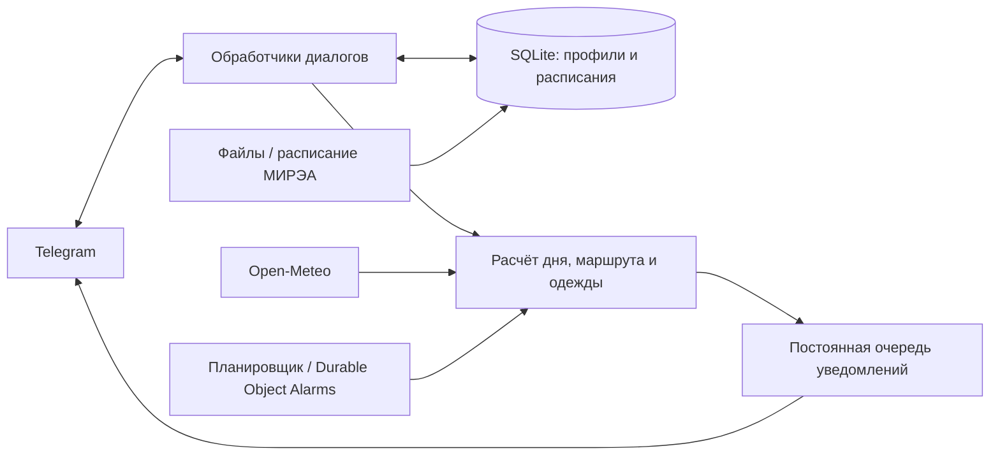

# Day Companion

[](https://github.com/alarongh/day-companion/actions/workflows/checks.yml)


Личный помощник в Telegram: подсказывает, когда проснуться и выйти из дома, какую верхнюю одежду выбрать, в какой аудитории следующая пара и когда пора ложиться спать.

Проект вырос из повседневной задачи: погода возле дома и в месте учёбы отличается, дорога занимает время, а обычные напоминания приходится постоянно перестраивать. Здесь расписание, маршрут, одежда и сон участвуют в одном расчёте. У каждого пользователя свой профиль.

## Возможности

- **Погода без расписания.** `/weather` показывает прогноз для отмеченных районов. Добавить точку на карте можно прямо в боте, без ИИ.
- **Погода по маршруту.** Несколько районов, время выезда и возвращения, почасовой прогноз. Для одежды учитываются минуты на улице, дождь, ветер и личная поправка комфорта.
- **Свой гардероб и сценарии.** Температурные диапазоны, приоритеты правил, защита от осадков; обратная связь «Холодно / Нормально / Жарко».
- **Расписание.** JSON/TXT, ICS, CSV и XLSX, чётные/нечётные недели, подгруппы, корпуса, разовые отмены и переносы. Есть подключение открытого сервиса расписания МИРЭА.
- **Уместные напоминания.** До выхода, перед парой с учётом перемены и перехода между корпусами, после своих событий. Напоминания «после возвращения» запускает кнопка «Я дома».
- **Подъём и сон.** Время рассчитывается от начала занятий, дороги, сборов и желаемой продолжительности сна. Ночные поездки сохраняют дату следующего дня; нехватка времени на сон отмечается явно.
- **Настройка через внешний ИИ.** Бот выдаёт промпт, пользователь возвращает JSON, проверяет изменения и подтверждает их. Устаревшая версия настроек не перезаписывает новую. Платный API ИИ не нужен.
- **Личные данные.** Отдельные профили в SQLite, экспорт и удаление своих данных, работа в личных чатах.

Пример утренней сводки с условными данными:

```text
Выход: 07:50
Дома при выходе: +5 °C, ощущается как +3 °C
В месте учёбы: +8…+11 °C
Возвращение домой: 15:20
Одежда: куртка — прохладное утро, возможен дождь
Первая пара: 09:00, математика, аудитория Б-312
```

## Как устроен



Логика расчётов отделена от Telegram и проверяется без сети. Два варианта запуска используют общие модели, обработчики и правила:

| Вариант | Telegram | Хранение и планировщик |
| --- | --- | --- |
| Python / Docker | aiogram, long polling | SQLite, асинхронный worker |
| Cloudflare Workers | webhook, компактный Bot API клиент | SQLite Durable Object, Alarms |

В облаке входящее обновление сначала сохраняется, затем обрабатывается сразу. Исходящие сообщения проходят через постоянную очередь, отправки одному пользователю выполняются последовательно, сетевые ошибки повторяются с задержкой. Alarms обслуживают напоминания и повторные попытки.

## Быстрый запуск

Нужны Python 3.14 и собственный бот, созданный через [BotFather](https://t.me/BotFather).

```powershell
git clone https://github.com/alarongh/day-companion.git
cd day-companion
python -m venv .venv
.\.venv\Scripts\python.exe -m pip install -r requirements.txt
Copy-Item .env.example .env
```

Вставь токен в локальный `.env`, поле `BOT_TOKEN`, затем:

```powershell
.\.venv\Scripts\python.exe -m companion.app
```

На Windows `run.ps1` также создаёт окружение и устанавливает зависимости. На Linux/macOS используй `.venv/bin/python` и `cp .env.example .env`.

Для просмотра погоды: `/start` → «Точки погоды» → добавь район и отметь его на карте. Градусы вводить не нужно.

Для полной настройки в Telegram: `/start` → `/config` → «Первичная настройка». После загрузки JSON проверь изменения, укажи районы точками на карте и включи `/notifications`.

Без токена и запросов к сети можно посмотреть демонстрацию:

```powershell
.\.venv\Scripts\python.exe -m companion.demo
```

Docker: создай `.env` и выполни `docker compose up -d --build`. В образ включён Tesseract для локального OCR. Ограничения проверок контейнера описаны в [VALIDATION.md](VALIDATION.md).

Размещение без работающего ноутбука: [инструкция Cloudflare](cloudflare/README.md). Для Workers Free нужно соблюдать актуальные бесплатные квоты аккаунта.

## Настройка и документация

- [Руководство пользователя](docs/USAGE.md): одежда, расписание, тихие часы, переход через полночь и условия напоминаний.
- [Формат настройки через ИИ](AI_SETUP.md), [JSON Schema](examples/configuration.schema.json), [учебный пример](examples/setup.example.json).
- [Проверки и ограничения](VALIDATION.md).

## Разработка

```powershell
.\.venv\Scripts\python.exe -m pip install -r requirements-dev.txt
.\.venv\Scripts\python.exe cloudflare/prepare.py
.\.venv\Scripts\python.exe -m pytest -q
.\.venv\Scripts\ruff.exe check companion tests scripts cloudflare/src
```

Тесты покрывают расчёты времени, погоду на маршруте, выбор одежды, разделение пользователей, импорт и изменение настроек, обработчики Telegram, повторы доставки и облачный webhook. GitHub Actions запускает тесты, линтер, автономное демо и проверку истории Git на секреты.

## Границы проекта

Дорога задаётся в минутах: текущие пробки и транспорт пока не подключены. Погода имеет разрешение прогнозной модели. В облаке PDF и фотографии сначала нужно преобразовать в JSON; локальное OCR принимает только поддерживаемые форматы таблиц. При сбое между отправкой сообщения и записью подтверждения возможен повтор.

Данные профиля доступны владельцу сервера; шифрования базы на уровне приложения нет. Бот сам не отправляет расписание внешнему ИИ: пользователь выбирает сервис и передаёт ему промпт. Удаление профиля не удаляет ранее созданные оператором резервные копии.

В репозитории находятся исходники и учебные примеры. Рабочие токены, база пользователей, личные координаты, журналы и параметры действующего развёртывания исключены из публикации.
